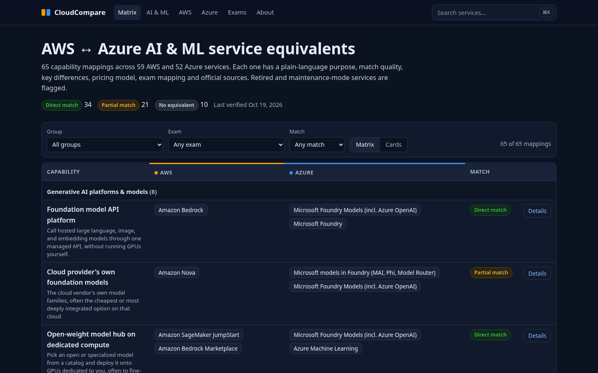
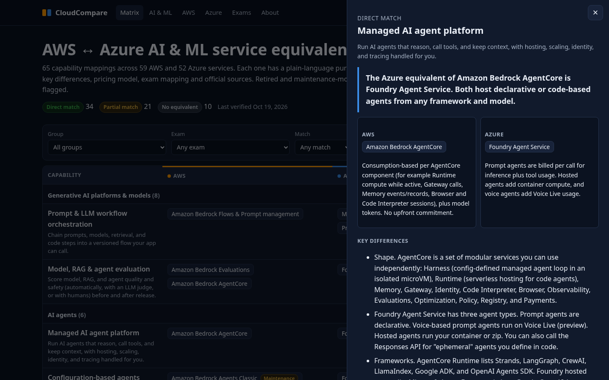
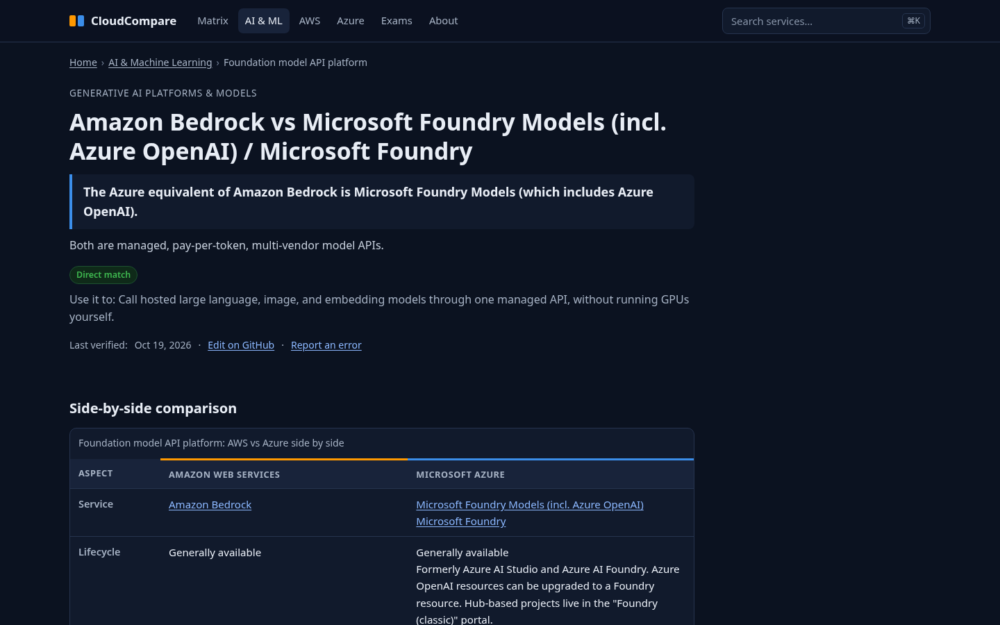
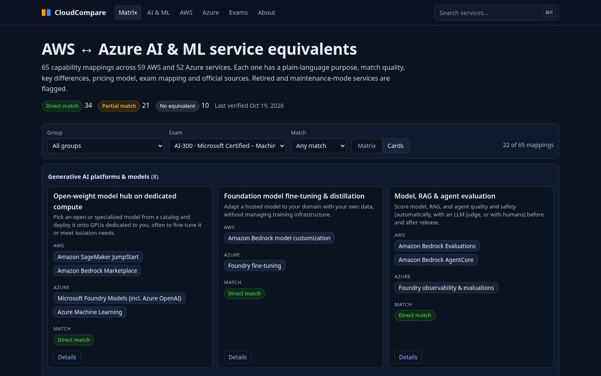
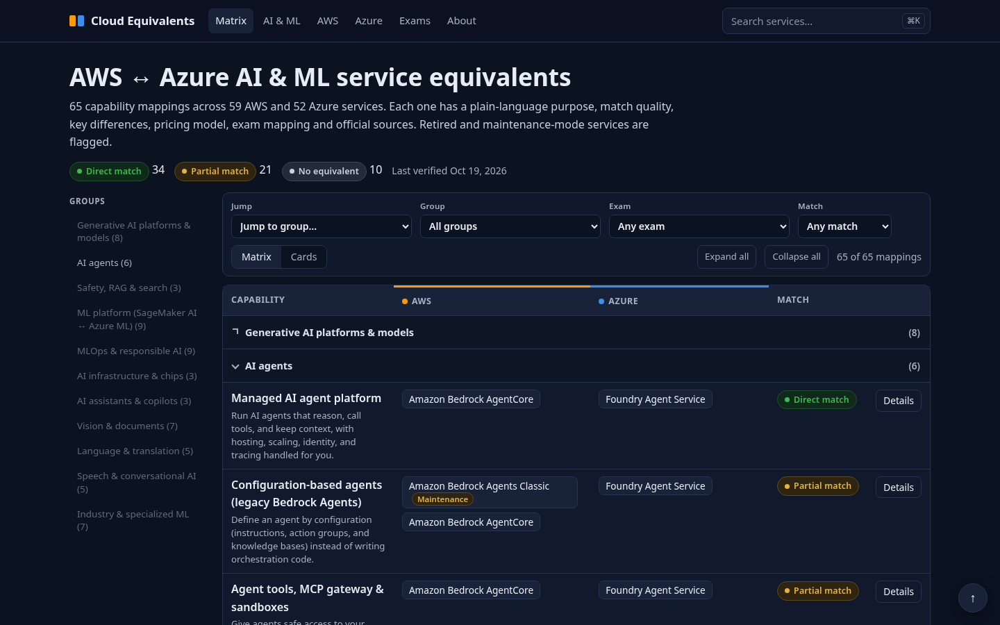
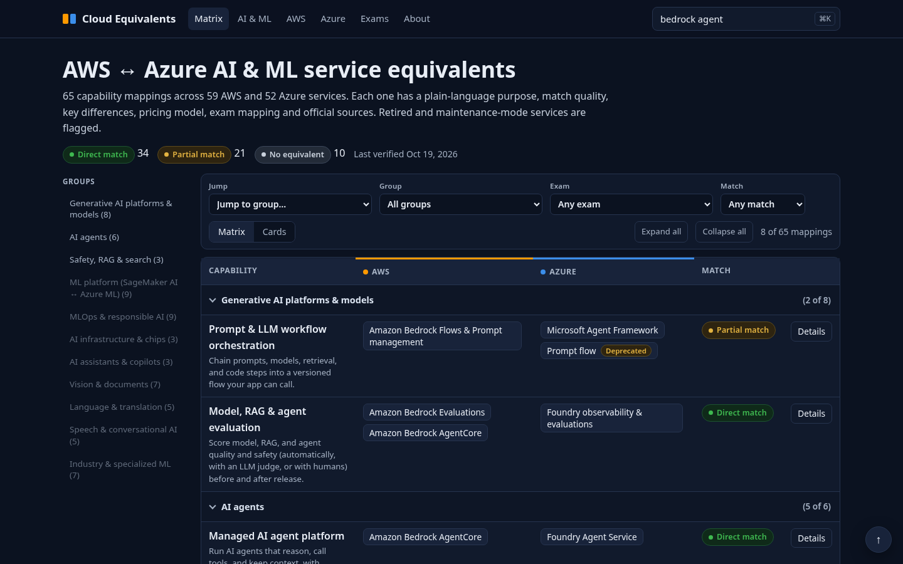
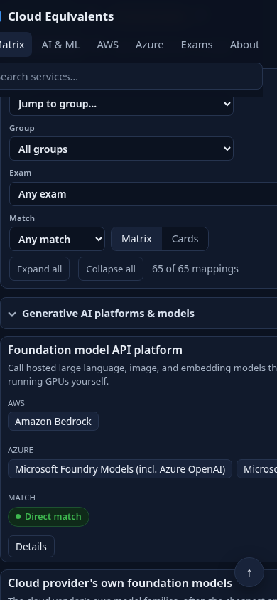

# Cloud Equivalents: AWS ↔ Azure service equivalents

**Live site:** [cameron-keene.github.io/cloudequivalents](https://cameron-keene.github.io/cloudequivalents) · **Repo:** [github.com/cameron-keene/cloudequivalents](https://github.com/cameron-keene/cloudequivalents)

An open-source, source-cited study guide that maps cloud services between providers. It goes deeper than a name-to-name table. Every mapping includes:

- a plain-language purpose
- match quality (direct, partial, or none)
- key differences
- the pricing model, with links to official pricing pages (no prices are quoted)
- related certification exams
- lifecycle status (preview, maintenance, sunset, deprecated, retired)
- official documentation sources

**Current scope:** AI & Machine Learning: 65 mappings, 59 AWS services, 52 Azure services, last verified 2026-10-19. The data schema already supports more providers (GCP and OCI are registered but disabled).


## Screenshots















## Quick start

```bash
npm install
npm run validate      # schema and reference checks on data/
npm run build         # writes the pre-rendered site to dist/
node scripts/check-site.mjs   # one H1, unique titles/descriptions, JSON-LD, internal links, OG images
npm run check-links   # HTTP-checks every URL in data/ (writes link-report.json)
npm run preview       # http://localhost:4173/
```

Requires Node 20 or later. The build needs no network access and no paid services. Open Graph images are rendered locally with `@resvg/resvg-js` using the bundled DejaVu fonts.

## Configuration

`site.config.json` holds every deploy-specific value in one place:

| key | purpose |
|---|---|
| `baseUrl` | Canonical origin, used for canonical URLs, sitemap, OG URLs, and JSON-LD. `https://cameron-keene.github.io/cloudequivalents` (custom domain `https://cloudequivalents.com` planned) |
| `repoUrl` / `repoBranch` | Target of the "Edit on GitHub" and "Report an error" links. `https://github.com/cameron-keene/cloudequivalents` |
| `activeProviders` | Provider columns to render. Each must also be `enabled` in `data/providers.yaml`. |

## Site structure

| URL | What |
|---|---|
| `/` | Interactive matrix: collapsible groups (Expand/Collapse all, remembered), Cmd/Ctrl+K search, group/exam/match filters, jump-to-group nav, detail drawer, and a Matrix/Cards toggle. Filter state is kept in the URL (`?q=&group=&exam=&match=&view=cards`). Without JavaScript it's a plain server-rendered table. |
| `/compare/aws-<slug>-vs-azure-<slug>/` | One fully pre-rendered page per mapping. Each has a direct answer, an HTML comparison table, differences, pricing, exams, FAQ, related links, sources, a last-verified date, and an edit link. |
| `/aws/<service>/` and `/azure/<service>/` | Hub pages ("Azure equivalent of X" and the reverse) |
| `/aws/`, `/azure/` | Service indexes |
| `/category/ai-ml/` | Category overview |
| `/exams/` | Certification exams mapped to comparisons |
| `/about/` | Methodology |

SEO and performance features:

- per-page `<title>`, meta description, and canonical URL
- Open Graph and Twitter cards with a per-page 1200×630 PNG
- JSON-LD (BreadcrumbList, TechArticle, FAQPage, plus WebSite/ItemList/CollectionPage where relevant)
- `sitemap.xml`, `robots.txt`, and a `noindex` 404 page
- system fonts only, with no layout shift
- content pages ship one ~300-byte inline script; the matrix JS (~6 KB) loads only on `/`, and drawer data (`/data/rows.json`) loads only when the drawer is first opened

## Data layout (one file per category, PR-friendly)

```
data/
  providers.yaml          # provider registry (aws, azure, gcp*, oci*); *disabled
  exams.yaml              # certification exams, status (current/beta/retiring/retired), notes
  services/aws.yaml       # one entry per service: slug, name, status, status_note, summary, docs, pricing
  services/azure.yaml
  categories/ai-ml.yaml   # category metadata, groups, and the mapping rows
```

A row (`data/categories/*.yaml`):

```yaml
- id: foundation-model-api          # stable id (used for anchors and "related")
  slug: optional-override           # optional; default is aws-<svc>-vs-azure-<svc>
  group: genai
  capability: Foundation model API platform
  what_for: One plain-language sentence about what you'd use it for.
  match: direct | partial | none
  answer: One-sentence direct answer first. Optional extra sentences.
  providers: { aws: [bedrock], azure: [foundry-models, foundry] }   # service slugs, primary first
  differences: [ ... ]
  pricing: { aws: "...model, no numbers...", azure: "..." }
  exams: { aws: [AIF-C01], azure: [AI-103] }
  faq: [ { q: ..., a: ... } ]       # optional; 2-3 FAQs are also derived automatically
  related: [model-customization]
  sources: [ https://docs.aws.amazon.com/..., https://learn.microsoft.com/... ]
  flags: [ "Anything not fully verified goes here" ]   # shown as "Verification notes"
```

Service URL segments drop a redundant provider prefix (`azure-language` becomes `/azure/language/`). `npm run validate` fails the build on any of these:

- an unknown service, exam, group, or related id
- an unused service
- a missing required field
- a duplicate compare slug

## Adding a provider (GCP, OCI, …)

1. Create `data/services/gcp.yaml` using the same fields.
2. Add `gcp: [...]` to `providers` (and optionally `pricing`/`exams`) on the rows.
3. Set `enabled: true` in `data/providers.yaml` and add `"gcp"` to `activeProviders`.

The matrix columns, comparison tables, pricing blocks, drawer, and hub pages are all generated from the provider list. No template changes are needed. Compare-page slugs remain based on the first two providers (AWS and Azure).

## Adding a category

Copy `data/categories/ai-ml.yaml` to a new file (for example `compute.yaml`) with its own `category:` block and `rows:`. Add any new services to `data/services/*.yaml`.

## Verification policy

- Every claim must be traceable to an official AWS or Microsoft page listed in `sources`, `docs`, or `pricing`.
- Lifecycle states come from vendor lifecycle and retirement pages. Retired services stay listed (marked retired), because people migrating still meet them.
- Never quote prices. Describe the billing model and link the official pricing page.
- If something can't be confirmed, add a `flags:` entry instead of stating it as fact.
- Bump `last_verified` only after re-checking the row's sources.

## Disclaimer

Community-maintained and not affiliated with Amazon Web Services or Microsoft. Product names are trademarks of their owners. Verify against the official documentation before making architecture, purchasing, or exam decisions.

## License

MIT (see `LICENSE`). Copyright (c) 2026 Cameron Keene.
